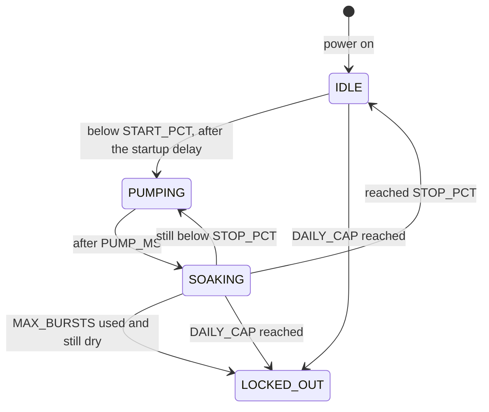

# Plant Waterer

An Arduino Uno sketch that waters up to three plants automatically. Each plant has its own soil moisture sensor and pump. When a plant's soil gets too dry, its pump runs in short bursts with a soak after each, until the soil is moist again. A small OLED screen shows what every plant is doing, and several safety checks stop or pause watering if something looks wrong.

## Features

- **Independent watering for each plant**, with its own thresholds, calibration and pump time.
- **Burst-and-soak watering:** 45-second bursts (about 50 mL each), then 10 minutes for the water to soak in before checking again.
- **Hysteresis:** watering starts below 35% moisture and continues until 45%, so a reading that hovers near one number can't trigger watering over and over.
- **Safety checks:**
  - **"Still dry" lockout:** if 4 bursts in a row don't reach the target, that plant stops (empty reservoir, loose tube, sensor out of the soil).
  - **Daily cap lockout:** more than 8 bursts for one plant in any 24 hours stops that plant (water running through the pot, bad readings).
  - **Sensor fault pause:** a reading far outside the sensor's calibration (loose or broken wire) pauses that plant until the reading is normal again.
  - **Startup delay:** no watering for 5 minutes after power-on, so a board that keeps restarting can't keep restarting the pumps.
  - **Watchdog timer:** restarts the board if it ever freezes, which switches every pump off.
- **OLED status screen:** moisture, countdowns, water given in the last 24 hours, and problems. It sleeps after a minute to prevent burn-in, wakes with a button press, and turns itself on when a plant has a problem.
- **Serial log** of every watering event, plus a status line every 5 seconds.

## How it works

Each plant moves through these states on its own:



The sketch never waits with long `delay()` calls. Every pass through `loop()` takes a fraction of a second, and each plant checks `millis()` to see whether it's time to move on, so all plants are handled side by side.

A locked-out plant stays locked out until the board is reset (reset button or unplugging it).

## Hardware

| Part | Notes |
|---|---|
| Arduino Uno | |
| 3 analog soil moisture sensors | One per plant. Capacitive sensors last much longer in soil than resistive ones. |
| 3 small pumps | This build doses about 50 mL in 45 seconds. Powered from the 12V supply through the relays. |
| Relay board, 3+ channels, 5V | Switches the pumps. |
| 0.96" 128x64 OLED, SSD1306, I2C | For a 1.3" SH1106 screen, see [Troubleshooting](#troubleshooting). |
| Momentary push button | Wakes the screen. A waterproof panel-mount button suits a sealed box. |
| 12V power supply | Must be able to run all three pumps at once. |
| 12V-to-5V buck converter | Powers the relay board. |
| Inline fuse | On the 12V supply's positive wire, rated a bit above the total pump current. |

Optional but recommended: an IP65 junction box with cable glands, lever connectors or a screw terminal shield for wiring, a 1N4007 diode across each pump, and an opaque, lidded reservoir.

## Wiring

| From | To |
|---|---|
| Sensor 1 / 2 / 3 signal | A0 / A1 / A2 |
| Sensor VCC and GND | Uno 5V and GND |
| Relay IN1 / IN2 / IN3 | Pins 2 / 3 / 4 |
| Relay VCC and GND | Buck converter 5V output and GND (leave the JD-VCC jumper on, if the board has one) |
| Each pump | 12V+ to the relay's COM terminal, NO terminal to pump +, pump - to ground |
| OLED SDA / SCL | A4 / A5 |
| OLED VCC and GND | Uno 5V and GND |
| Push button | Pin 7 and GND (no resistor needed; the sketch uses the built-in pull-up) |
| 12V supply + | Uno VIN, buck converter input, relay COM terminals |
| 12V supply - | Common ground for everything |

### Power notes

- **Power the Uno from 12V through VIN.** VIN has no reverse-polarity protection, so check the polarity with a multimeter before the first power-up.
- **Set the buck converter to 5.0V with a multimeter before connecting it.** Never connect its output to the Uno's 5V pin.
- **The Uno's 5V pin powers only the sensors and the screen.** The relay coils draw too much current for the Uno's regulator.
- **All grounds must be connected together**, but run pump power and ground back to the supply, not through the Uno.

## Software setup

1. Install the [Arduino IDE](https://www.arduino.cc/en/software).
2. Install the **U8g2** library from the Library Manager (tested with version 2.36.19).
3. Open `plant_waterer.ino`. The folder must stay named `plant_waterer`, because the Arduino IDE requires a sketch to be in a folder with the same name.
4. Select **Arduino Uno** and its port, then upload.
5. Open the Serial Monitor at **9600 baud**. Turning on its timestamps makes the log easier to read.

The sketch uses about 35% of the Uno's program storage and 40% of its RAM.

## Configuration

All settings are at the top of `plant_waterer.ino`, under "Settings: edit these before uploading". Most come as one value per plant.

| Setting | Default | What it does |
|---|---|---|
| `SENSOR_PINS`, `PUMP_PINS`, `BUTTON_PIN` | A0-A2, 2-4, 7 | Wiring |
| `DRY_RAW`, `WET_RAW` | 640/639/637, 284/287/291 | Each sensor's calibration (see below) |
| `SENSOR_MARGIN` | 50 | How far past calibration a reading can go before it counts as a sensor fault |
| `START_PCT`, `STOP_PCT` | 35, 45 | Start watering below this moisture %, keep going until this % |
| `PUMP_MS` | 45 seconds | Pump run time per burst |
| `ML_PER_BURST` | 50 | Water per burst, shown on the screen. Measure again if you change `PUMP_MS` |
| `SOAK_MS` | 10 minutes | Wait after each burst before checking again |
| `MAX_BURSTS` | 4 | Bursts in a row that can miss `STOP_PCT` before the "still dry" lockout |
| `DAILY_CAP` | 8 | Bursts per plant in any 24 hours before the daily cap lockout |
| `STARTUP_MS` | 5 minutes | No watering for this long after power-on or a restart |
| `SCREEN_ON_MS` | 1 minute | Screen sleeps this long after the last button press |
| `PRINT_MS`, `DISPLAY_MS` | 5 seconds, 1 second | Serial status line and screen refresh intervals |

Times are in milliseconds, written like `10UL * 60000UL`. The `UL` makes the Uno do the math with 4-byte numbers; without it, values above 32,767 overflow.

### Calibrating the sensors

1. Upload the sketch and open the Serial Monitor. The status line shows each sensor's raw reading (`P1 raw=512 35%`).
2. **Dry:** hold each sensor in the air and note its reading. That's its `DRY_RAW` value.
3. **Wet:** put each sensor in a glass of water, up to the line marked on it, and note its reading. That's its `WET_RAW` value.
4. Enter the numbers and upload again. Higher readings mean drier soil.

Re-check the calibration if you change how the sensors are powered.

### Choosing thresholds and the daily cap

- Note the moisture % on the screen when a plant actually needs water (the finger test works), and set that plant's `START_PCT` and `STOP_PCT` around it.
- One burst needs to raise the reading by at least (`STOP_PCT` - `START_PCT`) / `MAX_BURSTS` points (2.5 with the defaults), or the plant will lock out as "still dry". In big pots, lower `STOP_PCT` or raise `MAX_BURSTS`.
- Watch how many bursts each plant uses on a hot day, and set `DAILY_CAP` to about twice that.

## The screen

Each plant gets two rows. The screen has room for 4 plants.

```
PLANT 1      42%
 waiting  150mL
PLANT 2      31%
 PUMPING  0:39
PLANT 3       --
 SENSOR FAULT!
```

| Row 2 shows | Meaning |
|---|---|
| `waiting 150mL` | Nothing to do. The number is the water given in the last 24 hours |
| `PUMPING 0:39` | Pump running, with time left |
| `soaking 3:23` | Water soaking in, with time left before the next check |
| `starting 4:00` | Startup delay, with time left before watering is allowed |
| `LOCKED: refill?` | "Still dry" lockout: check the reservoir, tubes and sensor, then reset |
| `LOCKED: leak?` | Daily cap lockout: check for water running through or a bad sensor, then reset |
| `SENSOR FAULT!` (and `--` instead of %) | Sensor reading out of range: check its wiring. Watering resumes by itself once it reads normally |

The screen turns off one minute after power-on or the last button press. Pressing the button wakes it. If any plant is locked out or has a sensor fault, the screen turns on by itself and stays on until the problem is fixed.

## Serial messages

```
Starting - no watering for the first 5 minutes
Startup delay over - watering enabled
Plant 1: watering, burst 1
Plant 1: pump off, soaking
Plant 2: LOCKED OUT - still dry - check reservoir/sensor, then reset
Plant 2: LOCKED OUT - daily cap hit - check for leaks/sensor, then reset
Plant 3: SENSOR FAULT - reading out of range, check its wiring
Plant 3: sensor reading back to normal
P1 raw=512 35%  P2 raw=500 39%  P3 raw=1015 FAULT
```

If `Starting` appears when you didn't power the board on, it restarted. Repeated restarts usually mean a power dip when a pump starts.

## Testing before use

1. **Check the relay direction.** Put the tubes in a cup and power up. All relays should stay off at startup, and one should click on only when the log says `watering`. If it's the opposite, see [Troubleshooting](#troubleshooting).
2. **Measure the water per burst** into a measuring cup, and set `ML_PER_BURST`. Pump tubing wears, so check again every few months.
3. **Speed up the timings while testing:** for example, `STARTUP_MS` to `10000UL` (the startup message will then say "0 minutes"), `SOAK_MS` to `30000UL` and `DAILY_CAP` to 2. Then trigger each safety check on purpose: pull a sensor out of the soil, unplug a sensor, and let a plant hit the low cap. Put the real values back afterwards.
4. **Run all three pumps at once** and watch for unexpected restarts or a glitching screen.

## Troubleshooting

| Problem | Fix |
|---|---|
| Pumps run when they should be off | Your relay board is "low level trigger". In `setPump()`, change the line to `digitalWrite(PUMP_PINS[i], on ? LOW : HIGH);` |
| Screen stays blank | Check the wiring. If the screen uses I2C address 0x3D, add `screen.setI2CAddress(0x3D * 2);` before `screen.begin();` |
| Screen garbled or shifted a few pixels | It's probably an SH1106 chip. Change the `screen` line to `U8X8_SH1106_128X64_NONAME_HW_I2C screen(U8X8_PIN_NONE);` |
| Board restarts when a pump starts | Power dips or relay noise. Add a diode across each pump and a large capacitor (about 470 µF) on the 12V bus, and keep the relay board on the buck converter |
| Moisture readings drift over weeks | Water is getting into the sensor's electronics. Seal its edges with nail polish or epoxy and cover the top with heat-shrink |
| Button presses get missed after months | Add a 1 kΩ to 4.7 kΩ resistor from pin 7 to 5V |
| Arduino IDE asks to move the sketch into a new folder | The folder isn't named `plant_waterer`. Rename it to match the `.ino` file |
